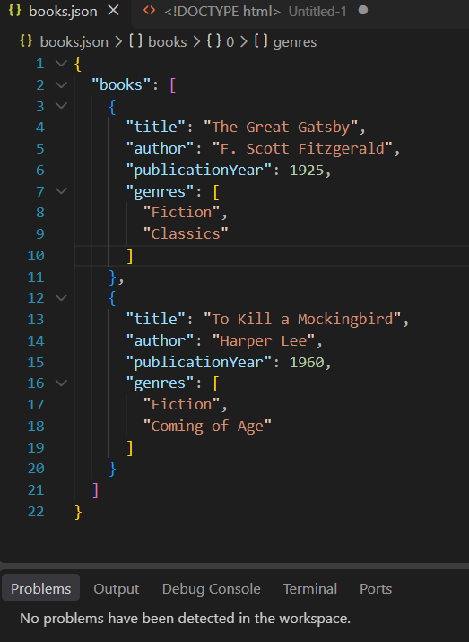
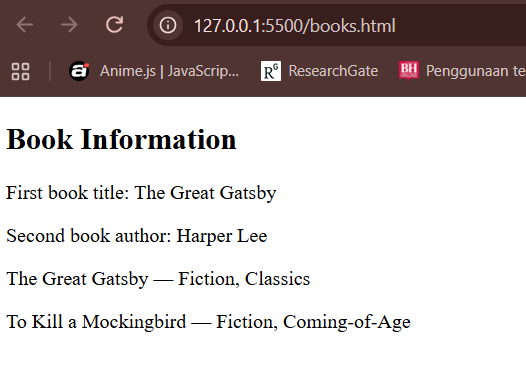
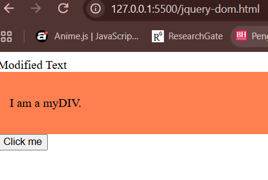
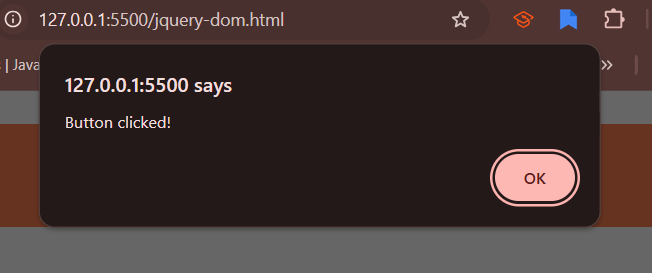

# bic21203-lab4b-json

**Name:** Afiq Asyraaf Bin Wan Ali  
**Faculty:** Fakulti Sains Komputer dan Teknologi Maklumat (FSKTM), UTHM  

## Overview
This repository contains the solutions for Lab 4b, focusing on modern web development techniques. The tasks include creating a valid JSON dataset, asynchronously retrieving and parsing that data using the native JavaScript fetch() API, and comparing native DOM manipulations with equivalent operations using the jQuery 4.0.0 library.

## Instructions to Run
* Important: Because Question 2 utilizes the fetch() API, books.html must be run using a local development server. Opening the file directly in a browser (resulting in a file:// URL) will block the request due to CORS security policies.

1. Clone this repository to your local machine and open the directory in Visual Studio Code.

2. Install the Live Server extension in VS Code if you do not already have it.

3. Question 2 (books.html): Right-click books.html in the file explorer and select Open with Live Server. The browser will open and display the book details fetched from books.json.

4. Question 3 (jquery-dom.html): Right-click jquery-dom.html and select Open with Live Server. Verify that the text has changed, the coral background is applied, and click the "Click me" button to trigger the jQuery alert.

## Output Screenshots

### Question 1: JSON Data Creation

### Question 2: Retrieve and Display JSON Data

### Question 3: Compare Native JavaScript and jQuery

